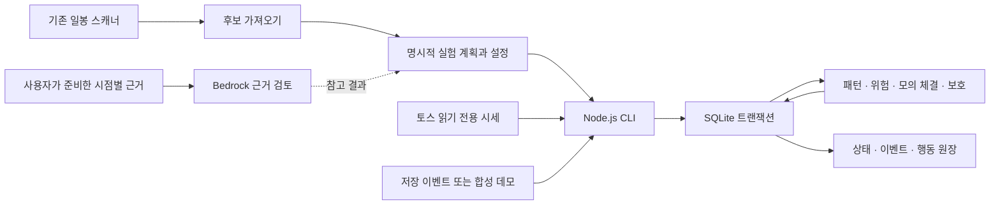
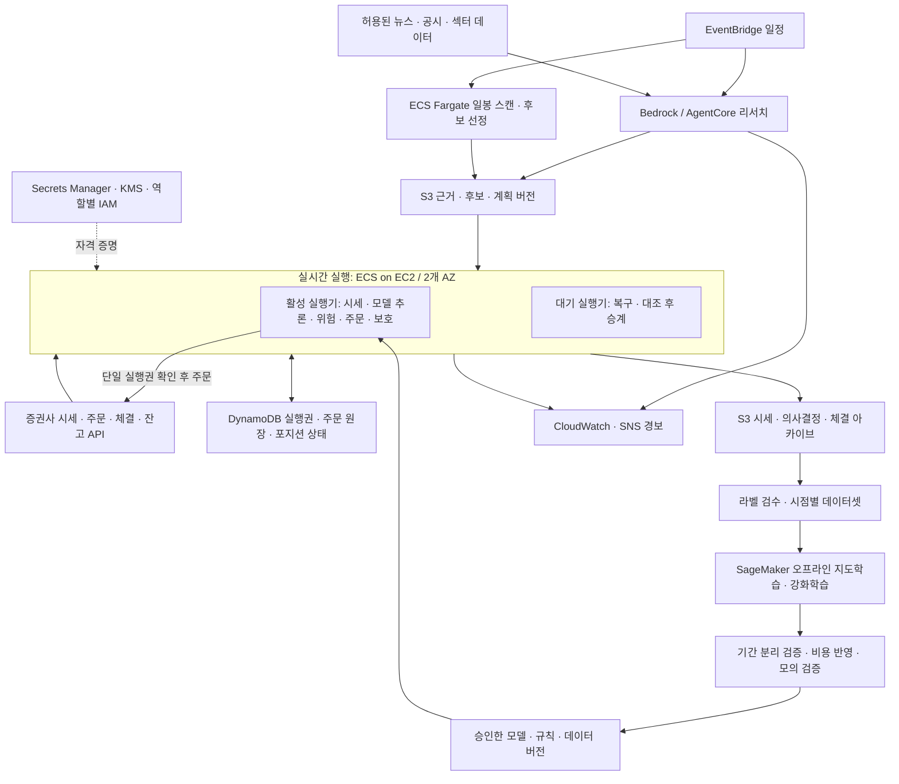

# 자동매매 아키텍처

기준일: 2026-10-29 KST. 이 문서는 **현재 구현**과 **목표 설계**를 구분한다. 설계 선택의 이유·사용자 확정 사항·미결정 사항은 [DECISIONS.md](DECISIONS.md), 실행 방법은 [README.md](README.md)에 둔다.

## 1. 전략에서 실행까지

1. 시장 리서치가 강세 섹터와 독립적으로 강한 개별 종목을 찾는다.
2. 기존 일봉 스캐너가 매매 규칙에 맞는 관찰 후보를 추린다. 리서치 결과만으로 주문하지 않는다.
3. 전날 종가베팅 물량을 다음 날 관리하면서, 같은 섹터·같은 종목을 포함한 장중 후보에서 돌파→눌림→재상승을 찾는다.
4. 진입 전 위험 검사를 통과하면 주문하고, 체결 수량에 즉시 초기 손절 보호를 부여한다.
5. 정해진 소폭 상승에서 본절로 스탑을 올린다. +3%·+5%에서 최초 체결 수량의 35%씩 청산하고 잔여 물량은 하락 전환·손절·종료 시각으로 관리한다.

학습 모델은 후보나 패턴을 평가하는 역할이다. 최대 3종목, 초기 손절 필수, 스탑 하향 금지 같은 보호 규칙은 모델 밖의 실행 코드가 강제한다. 이 분리는 목표 구조이며, 현재는 학습 모델 없이 규칙 가설로 동작한다.

## 2. 현재 구현: 단일 프로세스 모의매매

위 도식의 CLI·저장소·엔진은 한 프로세스 안의 모듈이다. 분리 배포된 서비스가 아니다. 후보를 실행 계획으로 바꾸는 과정도 아직 자동화하지 않았다.

| 구성 | 코드 | 현재 범위 |
|---|---|---|
| 일봉 후보 선정 | 별도 `jongga_scan.mjs` (저장소 미포함) | 기존 규칙 스캔 |
| 후보·근거 검토 | `research.mjs` | 스캔 가져오기, 제공된 근거의 시점·출처 검사, Bedrock 요청 |
| 시세 어댑터 | `toss.mjs` | 인증, 읽기 전용 시세·캘린더, 재연결 |
| 전략·위험·체결 | `engine.mjs` | 명시적 추세선 기반 규칙, 보호 상태, 모의 체결 |
| 영속화 | `store.mjs` | SQLite 상태·이벤트·행동 원장 원자적 저장 |
| 실행·제어 | `cli.mjs` | replay, toss, status, pause, resume, flatten, 내보내기 |
| 배포 포장 | `Dockerfile` | 컨테이너 정의만 작성; 빌드·AWS 배포 미검증 |

실제 주문 전송·증권사 잔고 대조·자동 뉴스 수집·학습 데이터셋·지도학습·강화학습·자동 종가주문은 미구현이다. Bedrock 및 실제 토스 키를 이용한 종단 연결도 미검증이다.

## 3. 목표 AWS 구조

서울 리전을 기준으로 한 **제안 설계**다. 아래 리소스가 생성되었다는 뜻이 아니다.

- **연구와 실행 분리:** LLM은 출처·시점이 있는 근거와 후보 평가를 남긴다. 주문 권한을 주지 않는다. 실시간 보호가 LLM 응답을 기다리지 않는다.
- **계좌당 주문 주체 하나:** 활성/대기는 동시 주문하지 않는다. 실행권의 세대 번호, 이전 실행기 차단, 미확정 주문 대조까지 설계해야 한다. DynamoDB 임대만으로 외부 주문의 중복 방지가 완성되지는 않는다.
- **장애 승계:** 대기는 증권사 미체결·체결·잔고와 내부 원장을 먼저 대조한다. API 응답이 끊긴 주문은 결과 미상으로 두고 조회한다. 확인 없이 동일 주문을 재전송하지 않는다.
- **보호:** 실거래에서는 체결 직후 실제 보호 수량을 확인한다. 지원되는 시장·시간에는 증권사 보호 주문을 검토하고, 자체 감시도 둔다. 어느 쪽도 갭·거래정지·통신 단절 시 손절 가격을 보장하지 않는다.
- **데이터 경로:** 영속 주문·위험 상태와 재생 자료는 보존한다. 손절 판단 경로에 리서치, 학습, 장시간 배치 작업을 넣지 않는다.
- **네트워크·운영:** 사설 서브넷, 필요한 고정 송신 IP/NAT, 최소 권한을 사용한다. 데이터 지연·연결 단절·주문 미확정·보호 불일치·실행권 상실을 감시한다. 세부 네트워크 구성은 배포 전에 확정한다.

첫 AWS 실험은 단일 EC2/EBS의 현재 모의 엔진으로 시작하는 제안이다. SQLite 파일은 로컬/EBS에서 사용한다. 이를 그대로 다중 AZ 공유 원장으로 사용하지 않는다. DynamoDB 전환에는 상태 모델·트랜잭션·복구 절차의 별도 구현과 검증이 필요하다.

## 4. 판단과 실행 기록: 현재 보장 범위

| 저장 항목 | 현재 기록 | 한계 |
|---|---|---|
| `paper.sqlite / events` | 처리한 정규화 입력 이벤트, ID, 입력 순서 | 증권사 원본 프레임 전체가 아니며 공급자 유실을 복원하지 못함 |
| `paper.sqlite / actions` | 패턴 돌파·눌림, 진입 대기·거절, 체결, 손절 설정·상향, 전량 청산, 데이터 거절, 운영 제어 등 | 모든 관망 분기·모든 내부 상태 변경에 설명이 붙는 것은 아님 |
| `paper.sqlite / state` | 최신 현금·포지션·대기 주문·보호 상태, 엔진 버전, 설정 해시 | 상태의 전체 과거 스냅샷이나 설정 원문은 DB에 보관하지 않음 |
| `config.json` | 데모가 사용한 실험 설정 원문 | 실시간 실행 시 운영자가 입력 설정 파일을 별도로 보존해야 함 |
| `ledger.jsonl`, `summary.json` | 내보내기 시점의 행동 원장·상태 요약 | 실행 중 DB를 대체하는 실시간 복제본이 아님 |
| 리서치 결과 JSON | 검토 명령 실행 시 입력 근거와 구조화된 결과 | 실제 호출 미검증; 모델 호출 전 과정의 감사 원장은 아직 아님 |

이벤트 적용·최신 상태·그 이벤트가 만든 행동은 한 SQLite 트랜잭션으로 저장한다. 동일 ID·동일 내용의 재입력은 체결을 반복하지 않고, 동일 ID·다른 내용은 오류로 거부한다. **이 보장은 현재 로컬 모의 처리 범위이며 실거래 주문의 정확히 한 번 전송 보장이 아니다.**

검증 예외로 롤백된 이벤트와 파싱 실패 원본은 DB에 남지 않을 수 있다. 원장을 변조 방지 저장소로 운영하지도 않는다. 현재 기록만으로 “왜 모든 순간에 매수하지 않았는지”까지 완전히 설명할 수 있다고 주장하지 않는다.

### 실거래 전 추가할 감사 기록

- 실행 ID, 코드 커밋, 설정 원문·해시, 규칙·모델·데이터셋 버전과 출처.
- 공급자 원본과 정규화 이벤트의 연결, 공급자 시각·수신 시각·판단 시각·전송/응답/체결 시각. 키·토큰·개인정보는 제거한다.
- 후보 채택/보류/탈락의 근거 요약, 패턴 특징값·모델 점수, 진입 및 보호 규칙의 통과/실패 사유. 반복 관망 기록량은 별도로 제한한다.
- 브로커 주문 식별자, 요청 의도, 부분체결·취소·정정, 결과 미상 상태와 잔고 대조 결과. 정정 주문 중 보호 공백도 관측한다.
- 장애·운영자 제어·실행권 변경과 복구 과정, 보관 기간·접근 권한·백업·복구 검증.

여기서 기록하는 판단 과정은 **근거와 규칙 평가 결과의 요약**이다. 모델의 내부 사고 과정에 의존하는 설계가 아니다.

## 5. 학습과 승격

반도체 섹터의 최근 1년 분봉을 활용하는 구체적인 연구 구조와 개발 순서는 [MODEL_RESEARCH.md](MODEL_RESEARCH.md)를 따른다. 먼저 장중 후보 평가 모델을 만들고, 종가베팅은 별도의 예측·보유 정책으로 후속 검증한다. 이는 모델 개발 순서의 제안이며 기존 두 전략 병행 요구를 바꾸지 않는다.

초기 학습과 추론은 사용자 확정에 따라 로컬 Mac에서 수행한다. 강의 이미지의 근거를 분봉 특징·형태 라벨로 옮기는 방법과 최적화·추론 구성은 [MODEL_METHODS.md](MODEL_METHODS.md)를 따른다. 위 AWS 구조는 후속 운영 목표로 남긴다.

목표 흐름은 시점별 시세·근거 보존 → 돌파/눌림/재상승 라벨 검수 → 지도학습 기준 모델 → 오프라인 강화학습 실험 → 기간을 나눈 검증 → 실시간 모의매매 → 소액 실거래 → 규모 확대다.

미래 데이터를 사용하지 않고, 종목·날짜별 데이터 누수를 막는다. 수수료·세금·스프레드·미체결·슬리피지를 반영한다. 승률만으로 승격하지 않고 순손익·최대 낙폭·급락 손실·보호 동작·주문 안정성을 함께 평가한다. 승격 기준 수치는 미결정이다. 실거래 중 온라인 강화학습으로 보호 규칙을 바꾸는 기능은 초기 범위에 넣지 않는 제안이다.

정확한 틱 봉이 필요하면 공급자의 데이터 완전성을 먼저 검증해야 한다. 현재 수신 스트림만으로 강의의 45/60틱 패턴을 정확히 학습했다고 볼 수 없다.

## 6. 운영 시작 전에 풀어야 할 연결점

1. 브로커별 KRX/NXT·정규장/시간외의 주문·취소·정정·보호·잔고 API를 실제 키로 확인한다.
2. 초기 손절 위치, 본절 이동 폭과 비용 반영, 추세 전환 정의, 세션별 종료 시각을 정한다.
3. 실제 입력량에서 처리 지연과 복구 시간을 측정한다. 이 결과로 저장소 분리와 Rust 적용 범위를 판단한다.
4. 모델 학습·검증·승격, 감사 로그, 계좌 대조와 단일 주문 주체를 구현한 뒤 소액 실거래를 검토한다.

공식 브로커 근거: [토스 REST 명세](https://openapi.tossinvest.com/openapi-docs/latest/openapi.json), [시세 명세](https://openapi.tossinvest.com/openapi-docs/latest/asyncapi.json), [FAQ](https://openapi.tossinvest.com/openapi-docs/faq.md). API 지원은 배포 시점에 다시 확인한다.
