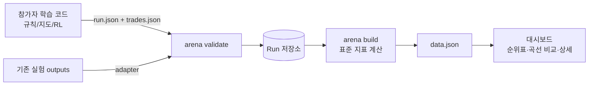

# Model Arena — 공동 모델 평가·비교 플랫폼 1차 기획

기준일: 2026-11-14. 상태: **1차 기획 + 로컬 프로토타입**. 운영 승격 기준이나 수익성 주장은 하지 않는다.

## 1. 왜 필요한가

현재 실험(`pattern-audit`, `escape`, `daytrade`, `selective-daytrade` …)은 각자 `statistics.json`·`trades.parquet`·`REPORT.html`을 만들지만 형식과 지표 정의가 실험마다 다르다. 여러 명이 지도학습·강화학습·규칙 모델을 동시에 만들면 다음 문제가 생긴다.

- 같은 이름의 지표(정확도·승률·MDD)가 사람마다 다르게 계산된다.
- 서로 다른 기간·종목·비용 가정의 결과를 한 표에 놓고 비교한다.
- 공개된 최종 기간(holdout)을 여러 번 열어 임계값을 고른다.
- 결과가 개인 PC의 `outputs/`에만 있어 함께 볼 수 없다.

## 2. 핵심 원칙

1. **지표는 플랫폼이 계산한다.** 참가자는 표준 형식의 *거래 목록*만 제출하고, 모든 지표는 같은 코드(`arena/metrics.py`)가 계산한다. 참가자 자체 집계는 참고값으로만 보존한다.
2. **비교는 같은 트랙 안에서만.** 트랙 = 종목 모집단 + 평가 기간 + 비용·체결 가정 + 의사결정 시점 규칙. 트랙이 다르면 같은 순위표에 놓지 않는다.
3. **개발(dev)과 시험(holdout)을 분리한다.** holdout 결과는 모델·임계값을 고정(해시)한 뒤 트랙당 제출 횟수를 제한한다. 화면에서 dev/holdout 배지를 항상 표시한다.
4. **모델 종류에 중립.** 규칙·지도학습·강화학습 모두 "언제, 무엇을, 얼마에 사고 팔았나"라는 동일 출력으로 평가한다. 강화학습 고유 정보(보상 곡선·에피소드 수)는 부가 정보로만 표시한다.
5. **기존 원칙 유지.** 비용 포함 순손익, 미청산은 분모에 남김, 승률만으로 승격하지 않음, 보호 규칙 변경 권한은 모델에 주지 않음(DECISIONS D12).

## 3. 표준 (Arena Standard v0)

### 3.1 트랙 정의 `arena/tracks/<track_id>.json`

| 필드 | 의미 |
|---|---|
| `track_id`, `title` | 트랙 식별자 |
| `universe` | 종목 모집단 설명·해시 |
| `decision_rule` | 의사결정 시점, 사용할 수 있는 정보(미래 누수 금지) |
| `windows.dev`, `windows.holdout` | 평가 기간(시작·끝) |
| `costs` | 수수료·세금·슬리피지 가정 |
| `gates` | 최소 거래 수, 최소 활동일 등 판정 기준(잠정) |
| `holdout_submissions_per_model` | holdout 제출 제한 |

### 3.2 제출물(Run) `runs/<run_id>/`

```
run.json      # 메타데이터 (필수)
trades.json   # 거래 목록 (필수)
curve.json    # 학습 곡선 (선택: RL 보상, 검증 손실 등)
```

`run.json` 필수 필드: `schema_version`, `run_id`, `track_id`, `split`(dev|holdout), `model.name`, `model.family`(rule|supervised|rl|baseline), `model.version`, `author`, `created_at`, `artifact_hash`(모델/코드 해시). 선택: `notes`, `params`, `source`(원 실험 경로).

`trades.json` 각 거래 필수 필드: `symbol`, `entry_at`, `exit_at`(미청산이면 null), `net_return`(비용 후, 소수 0.01=1%), `complete`(bool). 선택: `exit_reason`, `quantity`, `entry_price`, `exit_price`, `signal_at`.

### 3.3 표준 지표 (플랫폼 계산)

| 지표 | 정의 |
|---|---|
| 거래 수 / 활동일 | 진입 건수, 거래가 있었던 날짜 수 |
| **매매 정확도** | 비용 포함 본절 이상으로 *전량 청산*한 거래 / 전체 진입 (사용자 정의, 미청산은 실패) + Wilson 95% |
| 평균·중앙 순수익률 | 거래당 비용 후 수익률. 평균에는 일 단위 부트스트랩 95% 구간 |
| Profit factor | 이익 합 / 손실 합 절댓값 |
| 평균 이익·손실, 최악 거래 | |
| 누적 곡선 | 거래당 1단위를 걸었을 때 청산일 기준 누적 순수익률(%p, 단순합) |
| 최대 낙폭(MDD) | 위 누적 곡선의 고점 대비 최대 하락(%p) |
| 일간 Sharpe(연율) | 평가 기간 전 영업일(무거래일=0) 일별 합 수익률 기준 |
| 판정 | 트랙 `gates` 충족 여부 + 랜덤 기준선 대비 차이 |

계좌 시뮬레이션(동시 보유 자본 제약)은 v1에서 트랙별 표준 계좌 규칙을 정한 뒤 추가한다. v0의 단위 누적 곡선은 모델 간 *신호 품질* 비교용이며 실제 계좌 수익률이 아니다.

### 3.4 기준선

모든 트랙에 **무작위 기준선**을 둔다. 같은 후보 진입 집합에서 같은 비율로 무작위 선택한 결과의 분포(여러 seed)다. 강화학습이 "거르는 정책"을 학습했다면 최소한 이 기준선을 넘어야 의미가 있다.

## 4. 플랫폼 구성



| 단계 | v0 프로토타입 (이번) | v1 (팀 공유) | v2 |
|---|---|---|---|
| 저장소 | 로컬 `outputs/arena/runs/` | 공유 폴더 또는 S3 (`arena submit/pull`, 구현) | DB + 아티팩트 저장소 |
| 제출 | CLI `validate`·`import-*` | CLI `submit`(검증 후 업로드), 제출자 기록 | CI에서 자동 평가 |
| 계산 | 로컬 `build` | 업로드 시 서버에서 재계산 | holdout은 서버만 접근, 예측만 받음 |
| 화면 | 정적 HTML(`serve`) | S3+CloudFront+Basic 인증 (`infra/arena`, 구현) | 코멘트·승격 워크플로 |
| holdout 보호 | 표시만 | 제출 횟수 기록 | 정답 비공개 평가 서버 |

### 4.1 팀 공유 저장소 (구현됨)

`ARENA_REMOTE`에 공유 폴더 경로(NAS, Google Drive/Dropbox 동기화 폴더, 네트워크 드라이브) 또는 `s3://버킷/arena`를 지정한다. S3는 각자의 AWS 자격증명으로 `aws` CLI를 사용한다.

```
<remote>/runs/<run_id>/{run.json, trades.json, curve.json?, submission.json}
<remote>/site/{index.html, data.json}     # publish로 올린 공용 대시보드
```

- `submit`: 로컬 스키마 검사를 통과해야 업로드한다. `submission.json`에 제출자(git user.name), 시각, 내용 해시를 기록한다.
- **run_id는 불변**이다. 같은 내용을 다시 내면 `unchanged`, 내용이 다르면 거부되므로 새 run_id를 쓴다.
- holdout 제출은 (트랙, model.name)마다 `holdout_submissions_per_model` 횟수로 제한한다.
- `pull`은 모든 공유 run을 로컬로 받고, `build` 후 `publish`로 공용 화면을 올린다.
- Terraform(`infra/arena`): 전용 비공개·버전관리 S3(`runs/`, `site/`), `site/`만 읽는 CloudFront(OAC)와 Basic 인증 CloudFront Function, 팀 IAM 그룹(`runs/*`·`site/*` 읽기/쓰기, 삭제 없음). 사용법은 `infra/arena/README.md`.

## 5. 강화학습 연결 방식 (v0 구현)

- **환경** `arena/rl_env.py` `SelectiveReplayEnv`: gymnasium과 같은 `reset()`/`step()` 인터페이스이며 의존성은 numpy뿐이다(`as_gymnasium()`으로 감쌀 수 있음). 한 step은 시간순으로 들어오는 장중 진입 신호 하나다.
  - 행동: 0 = 건너뜀, k ≥ 1 = 사전 승인된 고정 청산 설정 k로 진입한다. 기본값은 `after_tp3/system_only` 하나뿐이다. 모델은 보호 규칙을 바꾸지 못한다(D12).
  - 관측: 그 시점에 알 수 있는 정보만 쓴다. D 종가 일봉 특징(강도 점수·순위, momentum20, atr20, ma60 기울기, 거래대금), 신호 시각, 손절 거리, 규칙 단계, 시장, 오늘 이미 진입한 수다.
  - 보상: 선택한 설정의 비용 후 실현 수익률이다. 건너뜀·미청산은 0으로, 플랫폼의 청산 기준 누적값과 같다. 하루 3건 상한은 시스템이 강제한다.
  - 장중 신호 특징(`diagnostics`)은 후보 371건 중 53건에만 연결되어 v0에서는 제외했다.
- **학습** `arena/rl_train.py`: REINFORCE(소프트맥스 선형 정책, 이동 기준선)로 2025-10-29~2026-06-30을 학습한다. 정규화 통계도 학습 구간에서만 구한다. 이후 `dev-late`(2026-07-01~10-28)에서 결정론으로 평가하고 표준 run과 학습 곡선을 제출한다.
- **공정 비교**: 모든 기존 run과 기준선에 같은 `dev-late` 슬라이스(`…@late`)를 만들어, RL과 같은 기간·같은 후보로 비교한다.

## 6. 역할 분담 (초안)

| 역할 | 책임 |
|---|---|
| 트랙 관리자 | 트랙 정의·기간·비용 확정, holdout 관리 |
| 모델 작성자 | run 제출, 모델 해시·재현 방법 기록 |
| 플랫폼 담당 | 지표 코드·스키마 버전 관리, 대시보드 |
| 검토자 | 승격 후보 확인, 한계 기록 |

## 7. 미결정 사항

- 승격 기준 수치(최소 거래 수·정확도 하한·MDD 한도) — v0 gates는 잠정값
- 표준 계좌 규칙(초기 자본, 동시 보유, 일 최대 진입)
- 공유 저장소 실제 위치(공유 폴더 vs S3 배포)와 팀원 IAM 연결
- RL 하이퍼파라미터 선택용 검증 구간(현재는 고정값, 학습 구간 안에서 별도 분리 필요)
- 다음 holdout 기간 확보 일정(현재 1년 자료는 대부분 개발에 노출됨)

## 8. 사용법

저장소 루트(로컬 작업공간에서는 `autotrader/`)에서 실행:

```sh
uv run python -m arena import-selective   # 기존 selective-daytrade v2 결과 → 표준 run (dev + dev-late)
uv run python -m arena baseline-random    # 무작위 기준선 5개 (dev + dev-late)
uv run python -m arena example-rl         # 온라인 bandit 시연
uv run python -m arena train-rl --seeds 1,2,3   # REINFORCE 학습 → dev-late 평가 run
uv run python -m arena validate           # 모든 run 스키마 검사
uv run python -m arena build              # 지표 계산 → outputs/arena/site/data.json
uv run python -m arena serve              # http://localhost:8765
```

팀 공유:

```sh
export ARENA_REMOTE=/Volumes/team/arena        # 또는 s3://<artifacts-bucket>/arena
uv run python -m arena submit <run_id> ...     # 검증 후 업로드 (불변)
uv run python -m arena remote-ls               # 제출 목록·제출자
uv run python -m arena pull && uv run python -m arena build
uv run python -m arena publish                 # 공용 대시보드 업로드
```

새 모델은 `arena.store.write_run(meta, trades, curve)`로 run을 만든다(예: `arena/examples/bandit_agent.py`, `arena/rl_train.py`). 다른 언어로는 3.2 형식의 JSON 파일을 직접 쓰면 된다.

대시보드: 순위표(정렬·종류 필터·기준선 대비 평균 수익) → **지표 비교**(체크한 최대 4개 run을 8개 지표 소형 다중 차트로 비교, 95% 구간과 무작위 기준선 범위 표시) → 누적 곡선 → **모델 지도**(모든 run을 두 지표로 배치하고 축을 선택, 클릭으로 비교 추가) → run 상세(분포·청산 사유·학습 곡선·제출자) 순서다. `?split=dev`처럼 URL로 구간을 지정할 수 있다.

테스트: `uv run python -m unittest arena.tests.test_arena arena.tests.test_remote_env`

## 9. 프로토타입 첫 결과 (2026-11-14, dev 구간)

- 기존 `selective-daytrade/20261101-v2` 18개 조합(진입 3 × 청산 정책 3 × 방식 2), 무작위 기준선 3개, RL 시연 1개를 표준 run 22개로 변환했다.
- 원 실험 수치와 대조: `confirmed/after_tp3/bear` 정확도 원 19.75%(채택 243건) vs 플랫폼 19.8%(제안 248건), Wilson 구간은 동일 공식으로 일치. 플랫폼은 계좌 제약 전 *제안 진입 전체*를 분모로 쓴다.
- 발견: 원 결과의 본절 성공 123건이 순수익률 −1e−16 수준(부동소수 오차)으로 저장돼 `>= 0` 단순 판정 시 정확도가 달라진다 → 트랙에 `success_tolerance` 1e−9를 명시했다.
- 발견: 08:00 프리마켓 진입은 UTC 날짜가 전날이다 → 모든 날짜 판정을 KST로 통일했다.
- 기존 18개 조합은 모두 거래당 평균 순수익률이 음수이고, half_percent 계열은 정확도가 높지만(본절 청산) PF가 0.1~0.2로 낮다. 정확도 단독 비교의 위험을 보여주는 사례다.
- RL 시연(문맥 bandit)은 평균 +0.04%였지만 95% 구간이 −0.31%~+0.37%로 0과 무작위 기준선 범위에 겹친다. 같은 기간에서 온라인으로 학습·평가한 시연이므로 성능 근거가 아니다.

## 10. RL v0 결과 (2026-11-14, dev-late 공정 비교)

- 후보 111건(take-all = `sel-v2.current.after_tp3.sys@late`) 중 REINFORCE는 seed별 83~88건을 골랐다. 거래당 평균 순수익은 −0.55~−0.57%로 take-all −0.59%와 거의 같고, 무작위 50% 기준선 5개 범위(−0.43~−0.69%) 안에 있다.
- 학습 구간에서는 탐욕 정책 누적이 −2%p에서 최고 +42%p(최종 +37%p)로 올랐지만 평가 구간에서는 개선이 없다. 학습 구간 과적합이며, 현재 관측 특징으로는 거를 신호를 찾지 못했다는 결과다.
- 같은 구간에서는 지도학습 하락 전이 청산(`…half_percent_delay1.bear@late`, −0.35%)이 가장 덜 나빴다. 모두 음수이므로 운영 승격 근거는 없다.
- 다음 후보: 장중 신호 특징 연결, 학습 구간 안의 검증 분리, 청산 설정 선택 행동(사전 승인 목록 안) 실험.
