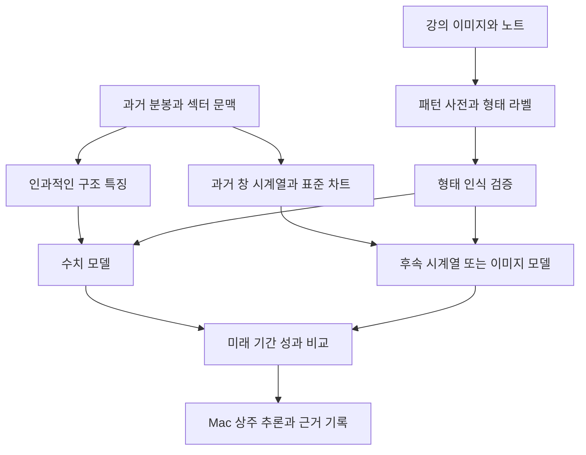

# 뒤틀림 모델의 학습 방법과 Mac 최적화

기준일: 2026-10-29 KST. 로컬 Mac에서 학습하고 초기 추론도 Mac에서 수행한다. 강의의 차트 해석을 관측 가능한 근거로 바꾸고, 형태 인식과 매매 성과를 따로 검증한다. 전체 데이터·분할·승격 절차는 [MODEL_RESEARCH.md](MODEL_RESEARCH.md)를 따른다.

현재 확인한 장비는 Apple M3 MacBook Air, 통합 메모리 16GB다. 아래 속도·메모리 목표와 탐색 범위는 초기 실험 제안이며 측정 결과가 아니다. 학습 환경과 실제 모델은 아직 구축하지 않았다.

## 강의에서 가져올 근거

원자료는 [강의 PDF](../강의/chart-flow.pdf)와 [강의 노트](../강의%20노트.md)다. PDF의 표시 페이지를 기준으로 4~25쪽을 이미지로 확인했고, 아래 네 페이지는 개별 확대해 확인했다. 강의 영상의 음성·전체 내용은 이번 근거 판독에 포함하지 않았다.

| 근거 ID | 확인한 위치 | 직접 보이는 내용 | 모델로 옮길 때의 가설 |
|---|---|---|---|
| L004 | PDF 4쪽 | 고점 하락·저점 상승 수렴, 수평 저항·저점 상승, 추세전환/뒤틀림 도식 | 고점·저점 기울기와 수렴 폭, 저항 돌파, 돌파 뒤 높아진 저점 |
| L005 | PDF 5쪽 | 상승추세는 저점 연결, 하락추세는 고점 연결, 횡보는 박스권 | 추세선의 anchor 종류를 구분하고 박스권을 별도 상태로 처리 |
| L010 | PDF 10쪽 | 고점 부근 이후 하락 구간을 표시한 틱 차트와 사후 설명 | 지지 이탈·반등 실패를 진입 회피용 반례 후보로 검수 |
| L022 | PDF 22쪽 | 저점이 높아지는 차트와 수평 저항 돌파 도식 | 저점 상승형 수렴과 돌파를 별도 패턴으로 분류 |

확인용 이미지는 [강의 근거 이미지 폴더](../outputs/model-research/lecture-evidence/), 원본 해시·판독 범위는 [근거 인덱스](../outputs/model-research/lecture-evidence/evidence-index.json)에 둔다. PDF의 틱 차트는 형태 가설의 근거다. 틱 봉의 간격이나 이동평균 기간을 분봉에 그대로 이식하지 않는다. 10쪽의 사후 하락 설명만으로 하락 전 정답 시각을 확정하지 않는다.

강의에 직접 보이는 내용, 노트에 기록한 사용자 확정 규칙, 구현자가 제안하는 정량화 가설을 각각 구분한다. ‘거래량 감소 후 재증가’, ‘섹터 상대강도’ 등의 추가 특징은 별도 실험 가설이며 위 네 이미지에서 검증된 수익 법칙으로 취급하지 않는다.

## 뒤틀림을 수치로 표현하는 방법

첫 패턴 사전은 하락추세 전환형, 저점 상승 수렴형, 수평 박스 돌파형, 실패·무효형으로 나눈다. 이들을 처음부터 하나의 뒤틀림 점수로 합치면 다른 구조를 같은 것으로 학습할 수 있다.

| 판단 근거 | 수치화 예 | 실패 또는 보류 근거 |
|---|---|---|
| 하락 압력 약화 | 확인된 고점들의 기울기와 고점 간 하락 폭 변화 | 낮아지는 고점과 저점이 계속 유지 |
| 저점 상승 | 최근 확인 저점 차이 / 과거 변동성 단위 | 눌림이 직전 구조적 저점을 하향 이탈 |
| 수렴 | 현재 추세선 간 폭 / 수렴 시작 시 폭, 폭의 감소 속도 | 가격대가 넓어지거나 선이 불안정 |
| 추세선 돌파 | 완료 봉 종가와 돌파 직전 고정 저항선의 거리 / ATR | 꼬리만 돌파하거나 다음 봉에서 저항 아래 복귀 |
| 눌림의 품질 | 돌파 후 되돌림 비율, 지지선과 거리, 소요 봉 수 | 깊은 되돌림, 지지선 이탈, 시간 만료 |
| 재상승 | 눌림 이후 당시까지의 단기 고점 회복, 회복 속도 | 저점 붕괴, 고점 회복 실패 |
| 거래량 확인 | 눌림 거래량 / 돌파 거래량, 재상승 거래량 / 눌림 거래량 | 가격 회복에도 참여 부족. 조건 효과는 별도 검증 |
| 시장 문맥 | 섹터 대비 수익률, 섹터 확산, 전일 일봉 지지 상태 | 시장 급락·섹터 약화·상위 시간대 저항 인접 |
| 진입의 경제성 | 손절까지 거리, 비용 대비 여유, 과거 저항까지 거리 | 손절 위험이나 비용이 허용 범위 초과 |

ATR은 완료된 과거 봉의 True Range를 정해진 창에서 평균한 변동성 단위로 정의하고 기간을 버전으로 고정한다. 값이 0이거나 관측이 부족하면 비율을 억지로 계산하지 않는다. 가격·기울기는 변동성 단위와 경과 봉 수로 정규화한다. 차트 화면의 픽셀 각도는 축척에 따라 달라지므로 특징으로 사용하지 않는다.

### 추세선과 저점의 시점 문제

1. 스윙 고점·저점의 발생 시각과 확인 시각을 각각 저장한다. 예를 들어 오른쪽 두 봉을 보고 확정하는 저점은 두 봉 뒤부터만 사용할 수 있다.
2. 하락 저항은 확인된 고점, 상승 지지는 확인된 저점을 사용한다. 두 anchor만 있을 때의 불확실성과 세 개 이상일 때의 선 적합 오차를 구분한다.
3. 후보 창은 우선 20·60·120분으로 사전 고정해 비교한다. 창과 anchor 조합을 모두 시험한 뒤 가장 예쁜 선을 사후 선택하지 않는다.
4. 추세선은 각 예측 시점까지의 자료로 계산한다. 돌파를 감지하면 해당 후보의 기준선을 고정하고, 나중에 선을 다시 그려 과거 돌파를 소급 변경하지 않는다.
5. 상태는 `관찰 → 돌파 → 눌림 → 재상승 확인 → 평가`다. 지지 이탈·기한 초과·데이터 누락이면 `무효 또는 보류`로 전환한다.

모든 단계를 필수로 하는 정책과 돌파 직후 평가하는 정책은 서로 다른 실험으로 기록한다. 재상승까지 기다리면 진입이 늦어지는 비용도 포함한다. 여러 근거는 서로 상관되므로 임의 가중치로 합산하거나 독립 확률처럼 곱하지 않는다.

## 이미지로부터 학습 근거를 만드는 방법

강의 이미지는 먼저 패턴 사전과 라벨 작성 지침을 만드는 데 사용한다. 수익이 난 강의 사례 몇 장만으로 범용 이미지 모델을 학습하지 않는다. 학습 표본은 확보한 분봉으로 예측 시점까지의 차트를 렌더링해 확장한다.

| 단계 | 작업 | 보존할 정보 |
|---|---|---|
| 근거 추출 | PDF 페이지와 필요한 영상 시각의 프레임 보존 | 원본 해시, 페이지/시각, 판독자와 확인 범위 |
| 형태 판독 | 추세선·저점·돌파·눌림·재상승 구간 표시 | 구조 유형, anchor, 관측 가능 시각, 설명, 불확실성 |
| 라벨 검수 | 명확한 사례와 반례를 같은 기준으로 재검토 | 판독자 간 불일치 또는 재검토 차이, 최종 상태 |
| 분봉 매핑 | 실험 분봉으로 해당 형태의 과거 창 생성 | 종목·거래일·판단 시각, 후보 ID와 원본 행 연결 |
| 미래 결과 계산 | 판단 시점 뒤 고정 정책의 매매 결과 계산 | net_R, 손절·미체결·모호한 봉과 종료 시각 |

형태 라벨은 `추세전환형`, `저점 상승 수렴형`, `박스형`, `실패형`, `판단 불가`와 현재 단계로 구성한다. 진입 순간에는 성공 여부를 알 수 없으므로 형태 라벨에 이후 상승 사실을 섞지 않는다. 미래 성과 라벨은 별도 컬럼으로 보존한다.

첫 검수 묶음은 약 200개의 후보를 목표로 하되 실제 확보 가능한 수를 기록한다. 성공·실패·비슷하지만 아닌 사례와 여러 국면을 포함한다. 검수용 균형 표본과 실제 발생 비율을 따르는 평가 표본을 구분한다. 가능하면 별도 판독자가 일부를 검토하고, 어려우면 같은 사례를 시간 간격을 두고 다시 판독한다. 불일치는 강제로 정답으로 만들지 않는다. 이 규모의 검수만으로 이미지 모델의 충분한 학습량을 확보했다고 판단하지 않는다.

### 이미지 누수와 차트 표현

- 판단 시각 오른쪽의 미래 차트를 잘라낸다. 축 범위도 미래 고가·저가를 보지 않고 정한다.
- 강의의 매수·매도 표시, 미래 수익률, 화살표, 해설은 판독 근거로만 보존한다. 원본 차트에 덮인 표시를 무리하게 지워 복원하지 말고, 가능하면 원시 분봉에서 깨끗한 학습 이미지를 다시 그린다.
- 종목명·날짜·가격 수준·색상 테마로 정답을 외우지 않도록 표현을 표준화한다. 같은 사건의 연속 프레임과 이미지 변형본은 같은 분할에 둔다.
- 시간축 압축과 과도한 가격축 변형은 패턴 의미를 바꿀 수 있다. 증강은 의미 보존을 검증한 범위에서만 쓴다.
- VLM의 설명은 라벨 초안으로 쓸 수 있으나 자동 정답으로 확정하지 않는다. 초기 운영 판단은 로컬 수치 모델로 시작한다.

## 모델을 만드는 순서

| 순서 | 모델 | 입력과 출력 | 채택할 이유 |
|---|---|---|---|
| A | 규칙 상태기와 규제 선형 모델 | 구조 특징 → 패턴 단계와 기대 net_R | 해석 가능한 기준과 라벨 오류 점검 |
| B | LightGBM | 구조·거래량·섹터·일봉 특징 → 기대 net_R | 비선형 근거 조합의 추가 효과 검증 |
| C | 작은 TCN 또는 1D CNN | 과거 64/128개 봉의 수익률·범위·거래량 → 형태와 성과 | 수치 요약이 놓치는 순서 정보 검증 |
| D | 작은 이미지 인코더 | 표준 차트 → 형태 점수 또는 임베딩 | 이미지 형태 정보가 수치·시계열보다 추가 가치를 주는지 검증 |
| E | 검증된 모델의 결합 | 각 모델의 과거 구간 밖 예측 → 최종 점수 | 상관된 모델을 합쳐도 개선되는 경우에만 채택 |

초기 제품 경로는 A와 B다. 형태 분류기는 검수 라벨이 충분할 때 추가하고, 형태 점수를 성과 모델의 입력으로 사용할 때는 과거 구간 밖 예측으로 생성한다. 같은 표본으로 학습한 형태 분류기의 훈련 예측을 그대로 다음 모델에 넣지 않는다. 결합 모델도 같은 원칙으로 학습한다.

TCN은 두세 개의 작은 블록, 채널 16/32, 짧은 창에서 시작하는 제안이다. 이미지 모델은 이미지 라벨과 분할 정합성이 확보된 뒤 추가한다. 수치 특징·시계열·이미지는 같은 분봉에서 나온 정보이므로 이미지가 더 많은 정보를 준다고 가정하지 않는다.

형태 정확도와 매매 성과는 별도 보고한다. 뒤틀림처럼 보이지만 비용을 이기지 못하는 사례, 형태는 약해도 성과가 있는 사례를 나눠 오차를 분석한다. 미래 성과는 기존 고정 청산 정책으로 평가하고, 패턴 임계값과 청산 정책을 동시에 끝없이 조정하지 않는다.

## 성능을 최적화하는 순서

| 우선순위 | 최적화 방법 | 효과를 확인하는 실험 |
|---|---|---|
| 1 | 누락·시점·기업행동·라벨 오류 수정 | 같은 모델로 수정 전후 미래 성과와 오류 사례 비교 |
| 2 | 구조 특징 개선 | 고점·저점만, 거래량 추가, 섹터 추가, 일봉 추가를 순서대로 비교 |
| 3 | 어려운 반례 추가 | 가짜 돌파·저점 붕괴·고점 추격·거래량 부족의 오탐 감소 확인 |
| 4 | 모델 용량과 규제 조정 | 작은 모델과 큰 모델의 월별 미래 성과·과적합 차이 |
| 5 | 진입 임계값과 관망 정책 | 선택률·기대값·누락 기회·낙폭의 관계 비교 |
| 6 | 계산량과 추론 경로 개선 | 지연·메모리·발열과 의사결정 동일성 비교 |

전일 20일선과 최신 기준봉 시크릿선은 강의·노트의 상위 문맥으로 추가할 수 있다. 240일선까지 사용할 경우 전체 평가 시작 이전 **최소 240거래일의 일봉**이 필요하다. 240일 분봉까지 추가 수집해야 한다는 뜻은 아니다. 이력이 짧은 종목은 결측 사유를 기록하며 창이 다른 이동평균으로 조용히 대체하지 않는다. 당일 미완성 일봉으로 확정 기준봉을 갱신하지 않는다.

### 제한된 하이퍼파라미터 탐색

LightGBM의 첫 탐색은 약 30회, 동시에 한 실험으로 시작한다. `num_leaves` 7/15/31, `max_depth` 3/5/7, `learning_rate` 0.02~0.1, `min_data_in_leaf` 100/300/1000, L2 규제 0/1/10을 후보로 제안한다. 데이터 크기에 맞지 않는 leaf 표본 수와 깊이·leaf 조합은 제외한다. 최대 1,500회 반복과 조기 종료를 함께 검토한다.

leaf 수·최소 표본·깊이·규제·조기 종료의 역할은 [LightGBM 튜닝 지침](https://lightgbm.readthedocs.io/en/latest/Parameters-Tuning.html)을 따른다. 탐색 도구를 도입할 때는 [Optuna의 TPE와 pruning](https://optuna.readthedocs.io/en/stable/tutorial/10_key_features/003_efficient_optimization_algorithms.html)을 검토한다. 이 범위가 최적값이라는 뜻은 아니다.

탐색은 학습 구간 안의 시간 순서 검증에서만 수행한다. 조기 종료·확률 보정·거래 임계값 선택도 내부 검증에 포함한다. 허용 낙폭과 최소 유효 거래 수를 제약으로 두고, 그 안에서 여러 내부 검증 기간의 일별 순손익 중앙값 등 사전 고정 지표로 비교한다. 최종 2개월을 탐색·pruning·모델 선택에 사용하지 않는다.

예측 오차가 줄어도 계좌 성과가 나빠질 수 있으므로 예측 지표와 포트폴리오 재생을 모두 확인한다. 모델 선택을 위한 수익 지표·제약 수치는 최종 시험 전에 명시한다. 시도한 설정과 실패한 실험도 보존한다.

### 필수 비교 실험

1. 가격 구조만 사용한 모델 대비 거래량·섹터·일봉 문맥 각각의 추가 효과.
2. 단일 창 대비 여러 시간 창, 규칙 anchor 대비 확인된 pivot anchor.
3. 수치 모델 대비 시계열 모델, 같은 분할에서 이미지 추가의 효과.
4. 종목을 일부 제외하거나 특정 월을 제외했을 때의 성과 안정성.
5. 비용 확대·한 봉 지연·모호한 봉의 불리한 순서·미체결 증가에 대한 민감도.
6. 형태 판독의 불일치 사례와 자신 있게 틀린 예측의 원인 분석.

특징 중요도와 모델 기여도는 모델이 무엇을 사용했는지의 단서다. 거래량이나 패턴이 수익의 원인이라는 증명으로 해석하지 않는다. 같은 날의 여러 후보를 묶어 비교하고 신뢰구간도 거래일 블록 기준으로 계산한다.

## Mac에서 학습과 추론하는 구성

| 영역 | 초기 구성 | 최적화 방법 |
|---|---|---|
| 환경 | 프로젝트 전용 Python 가상환경, arm64 의존성 고정 | 현재 OS와 패키지 호환성 확인 후 설치. 시스템 환경에 혼합 설치하지 않음 |
| 데이터 | 날짜·종목별 Parquet와 선택적 로딩 | 필요한 열·기간만 읽고 특징을 버전별 캐시 |
| 수치 학습 | LightGBM CPU, 첫 실험 4 threads | 2/4/8 threads 비교 후 시간·응답성 기준으로 선택 |
| 딥러닝 실험 | PyTorch CPU 기준과 MPS 비교 | 작은 batch부터 증가, 지원 연산·정확도·메모리 검증 |
| 초기 추론 | 모델을 한 번 로드하는 Python 상주 프로세스 | 매 봉 프로세스 생성 금지, 종목별 최근 창 유지 |
| 실행 연결 | 기존 Node.js와 로컬 IPC로 입력·결과 전달 | 요청 ID·시각·모델/특징 버전 검증, 기한 지난 응답 폐기 |
| 경량화 | 필요할 때 신경망의 Core ML 변환 비교 | 변환 전후 수치와 진입 판단 일치, 실기 지연 측정 |

PyTorch의 MPS는 Apple GPU를 사용하는 경로이며 가용 여부를 실행 환경에서 확인해야 한다. MPS 사용을 Neural Engine 사용으로 기록하지 않는다. 근거는 [PyTorch MPS 문서](https://docs.pytorch.org/docs/2.15/notes/mps.html)다. Core ML 변환·압축의 정밀도와 속도는 모델·장치별로 달라 실제 비교해야 한다. [Apple 최적화 워크플로](https://apple.github.io/coremltools/docs-guides/source/opt-workflow.html)

초기 수치 모델을 Core ML로 바꾸는 작업은 넣지 않는다. LightGBM의 네이티브 CPU 추론을 먼저 측정한다. 신경망의 FP16·양자화·압축도 정확도와 결정 임계값 근처의 뒤집힘을 검증한 뒤 적용한다. 압축률을 속도 향상률로 해석하지 않는다.

### 메모리와 실행 지연 목표

16GB 장비에서는 첫 학습 작업의 peak RSS를 8GB 이내로 관리하는 목표를 제안한다. 실제 사용량을 측정하며 swap이 늘거나 UI 응답이 나빠지면 동시 작업·특징 행·batch를 줄인다. 다중 프로세스에 같은 데이터 전체를 복제하거나 학습·대형 영상 처리·실시간 추론을 함께 실행하지 않는다.

첫 추론 벤치마크는 20/50/100종목의 완료 봉 배치에서 수행한다. 다음은 측정 목표이며 보장 성능이 아니다.

- 한 봉 배치의 특징 갱신+모델 추론 p95 1초 이내를 초기 목표로 둔다. 공급자 봉 도착 지연과 모델 처리 시간은 분리한다.
- 특징 계산, 모델 호출, IPC, 전체 지연의 p50/p95/p99와 peak RSS를 기록한다.
- 모델 로드·첫 호출과 워밍업 후 호출을 나누고, 30분 이상 반복했을 때 발열·지연 변화를 측정한다.
- 비동기 GPU 작업은 완료 시점까지 동기화해 측정한다. 같은 입력에 CPU·MPS·변환 모델의 출력과 거래 결정이 얼마나 다른지 비교한다.
- 추론 지연·버전 불일치·결측·자료 지연 시에는 신규 진입을 보류한다. 기존 포지션의 보호 루프는 모델 응답과 무관하게 계속 실행한다.

정상 정규장으로 예상했던 시간대와 데이터가 맞지 않거나 Mac 절전·네트워크 단절이 발생하면 로그를 남기고 신규 신호를 중지한다. 학습과 모의 운영 시간을 분리하고, 새 모델은 버전을 바꿔 명시적으로 로드하며 이전 모델로 복귀할 수 있게 보존한다.

## 매 판단에 남길 근거

결과에는 종목·판단 시각·후보 ID·모델 버전·데이터 기준 시각·패턴 단계·기대 net_R·선택 임계값·결정을 기록한다. 근거는 관측값과 모델의 해석을 구분한다.

예를 들어 ‘확인된 저점이 이전 저점보다 높음’, ‘돌파 직전 고정한 저항선 위에서 완료 봉 마감’, ‘눌림 중 구조적 지지 유지’는 실제 특징값과 함께 남긴다. 관망이면 ‘재상승 미확인’, ‘비용 반영 기대값 부족’, ‘자료 지연’, ‘위험 한도 초과’처럼 구체적인 이유를 남긴다. 이런 설명은 내부 사고 과정이나 미래 수익 보장이 아니라 관측 근거와 정책 적용 기록이다.

## 바로 진행할 작업

1. 강의의 네 근거와 사용자 노트로 첫 패턴·실패 사례 라벨 지침을 고정한다.
2. 분봉 공급자의 1년 조회를 검증하고 대형·중소형 종목의 작은 원본 자료를 확보한다.
3. 미래 변경 불변성 검사를 갖춘 pivot·추세선·상태기와 특징 계산을 구현한다.
4. 약 200개 검수 후보를 구성하고 형태 라벨과 미래 성과 라벨을 분리한다.
5. 규칙·선형·LightGBM을 같은 분할과 비용으로 비교한다.
6. 선택한 모델을 Mac 상주 추론에 연결하고 재생 일치·지연·실시간 모의를 검증한다.

1년 분봉 접근과 검수 라벨이 확보되기 전에는 학습 완료나 뒤틀림 판별 성능을 주장하지 않는다. 강의 이미지의 패턴을 정량화한 방법도 실제 분봉의 미래 성과로 통과 여부를 결정한다.
