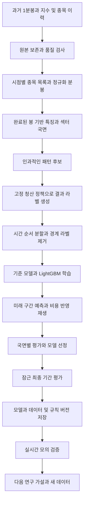

# 반도체 분봉 모델 아키텍처와 개발 프로세스

기준일: 2026-10-29 KST. 목표는 최근 1년의 반도체 분봉으로 **돌파 후 눌림과 재상승 후보를 평가하고, 비용과 위험을 감안해 진입할 기회를 고르는 모델**을 만드는 것이다. 섹터 상승기 수익뿐 아니라 하락기 진입 회피와 손실 감소를 함께 검증한다.

사용자 확정 범위는 모델 개발 집중, 반도체 섹터, 최근 1년, 분봉 활용, 로컬 학습과 초기 Mac 추론이다. 강의 이미지도 판단 근거로 활용할 수 있다. 아래 국내 주식 대상, 보유 시간, 모델 종류, 분할과 통과 기준은 첫 실험을 위한 설계 제안이다. 현재 모델 성능이나 실제 상승·하락 기간을 측정한 결과가 아니다.

뒤틀림의 구체적인 정량화, 강의 이미지 라벨링, 학습·최적화 방법과 Mac 추론 구조는 [MODEL_METHODS.md](MODEL_METHODS.md)에 둔다.

## 첫 실험의 범위

| 항목 | 제안 |
|---|---|
| 대상 | 국내 반도체 종목의 시점별 목록과 반도체 지수 또는 ETF 기준선 |
| 기간 | 최신 완결 거래일까지 12개월. 최초 계획은 2025-10-29부터 2026-10-28까지이며 공급자 완결성을 확인해 고정 |
| 준비 기간 | 위 기간 이전 최소 60거래일의 문맥 데이터. 강의의 240일선까지 사용하면 최소 240거래일의 일봉 확보. 12개월 평가 성과에는 포함하지 않음 |
| 입력 | 1분 OHLCV와 거래대금, 완료된 5분·15분 봉, 전일까지의 일봉 |
| 세션 | KRX 정규장의 연속매매 구간부터 시작. 동시호가·NXT·시간외는 별도 세션과 후속 실험으로 분리 |
| 의사결정 | 완료된 1분 봉에서 후보를 평가하고 다음 거래 가능한 시점에 진입 시도 |
| 매매 방향 | 매수와 관망. 하락장 수익을 내는 공매도 모델은 별도 문제로 둠 |
| 첫 모델 | 전 종목·전 국면을 함께 학습하는 LightGBM과 단순 기준 모델 비교 |
| 첫 평가 대상 | 장중 진입 품질. 기존 종가 보유 물량은 합산 위험과 슬롯 제약에 반영 |
| 이후 확장 | 장중 모델 검증 후 종가베팅 전용 라벨·익일 갭·보유 정책을 따로 설계 |

현재의 45/60틱 패턴을 분봉에서 그대로 재현한다고 가정하지 않는다. 분봉에 맞는 돌파·눌림·재상승의 정의를 만들고, 기존 전략과의 차이를 기록한다.

## 연구 아키텍처

분봉 기반 연구는 로컬 Mac의 Python 단일 배치 프로젝트로 시작한다. 원본·정규화 자료·특징·예측은 Parquet, 실험 설정과 요약은 JSON, 보고서는 Markdown으로 보존한다. 수치 모델은 CPU에서 먼저 재현하며 초기 추론도 Mac에서 수행한다. 시계열·이미지 모델은 필요할 때 MPS와 CPU를 비교한다. AWS 이전·분산 학습·온라인 특징 저장 서비스는 후속 필요가 확인될 때 검토한다.

기존 Node.js 실행기는 시세 수신·모의 체결·포지션 보호를 계속 담당한다. Python 연구 결과는 우선 오프라인 예측 파일로 연결하고, 모의 검증이 필요할 때만 상주 추론 경로를 추가한다. 실시간 입력과 학습 입력은 동일한 특징 정의와 버전을 사용해야 한다.

## 데이터 계약과 수집 순서

### 공급자 검증

전체 수집 전에 대형주·중소형주 각 1종목과 기준 지표를 골라 오래된 날짜, 최근 날짜, 거래정지 또는 무거래 사례의 실제 응답을 확인한다. 공급자의 1분봉 보존 기간, 페이지 처리, 호출 제한, 거래대금 제공 여부, 수정주가 방식, KRX·NXT·통합시세 구분과 사용 권한을 확인한다. 1년치 조회가 불가능하면 다른 허용된 공급자로 확보한 뒤 학습한다.

기존 실시간 수신 로그나 합성 데모는 과거 1년의 완전한 학습 자료를 대신하지 않는다. 데이터 공급자 선택은 아직 확정하지 않았다.

### 필수 자료

| 자료 | 필수 항목과 용도 |
|---|---|
| 원본 1분봉 | 공급자, 종목 식별자, 거래소, 세션, 봉 시작·종료 시각, OHLC, 거래량, 거래대금, 수집 시각 |
| 시점별 종목 목록 | 편입·편출 효력일, 당시 반도체 분류, 상장·상장폐지·종목코드 변경 이력 |
| 기준 지표 | 반도체 지수 또는 ETF, KOSPI·KOSDAQ 문맥. ETF 사용 시 추적 차이와 비용 영향을 명시 |
| 거래일과 기업행동 | 거래정지, 세션 변경, 분할·병합·배당락, 당시 적용 가능한 수정계수 |
| 비용 설정 | 적용 기간·시장별 수수료와 세금, 추정 스프레드·슬리피지, 출처와 확인일 |
| 후속 모의 자료 | 실제 호가·잔량·수신 시각과 지연, 모의 주문·체결·거절 기록 |

현재 잘 알려진 반도체 상승 종목만 과거로 가져가지 않는다. 당시 섹터 목록을 복원하지 못하면 처음부터 고정 바스켓 실험으로 명명하고, 전체 반도체 섹터에 일반화하지 않는다. 섹터 내 메모리·장비·소재 등 하위 분류도 보존해 특정 집단에 성과가 몰리는지 본다.

### 정규화와 품질 관문

- 기본 키는 공급자·거래소·종목·세션·봉 시작 시각이다. 중복 충돌은 원본을 보존하고 해결 규칙을 기록한다.
- 시각은 UTC로 저장하고 KST 거래일을 함께 둔다. 봉 시작/종료 타임스탬프와 수신 가능 시각을 분리한다.
- 정상 무거래, 거래정지, 공급자 누락을 구분한다. 누락된 가격을 보간해 매매 기회를 만들지 않는다.
- OHLC 순서, 음수 거래량, 누적/구간 거래량 혼동, 거래대금 단위, 수정/비수정 가격 혼합을 검사한다.
- 일부 날짜·종목의 일별 합계와 가격을 공급자 일봉 등과 대조한다. 거래소·세션 범위가 같아야 비교한다.
- 기업행동 전후 가격은 수익률 계산에서 일관되게 처리하되, 체결과 호가단위 검사는 당시 실제 가격을 쓴다.
- 파일별 해시와 공급자·조회 조건·기간·품질 플래그를 manifest에 기록한다. 제외 행과 이유도 남긴다.

완료 조건은 종목·날짜·세션별 커버리지 표, 누락 원인, 기업행동 처리와 재수집 결과를 확인하고 사용할 구간을 확정하는 것이다. 불명확한 누락 구간은 해당 예측 창과 라벨 창에서 제외한다.

## 섹터 상승과 하락을 모델에 반영하는 방법

미래 차트를 보고 붙인 상승장·하락장 이름을 실시간 입력으로 사용하지 않는다. 국면은 예측 시점에 알려진 정보로 계산하고, 모델 입력과 성과 분해에 공통으로 쓴다.

| 층위 | 관측값 | 역할 |
|---|---|---|
| 일별 추세 | 전일까지의 섹터 20일 수익률, 20일·60일 이동평균 관계와 기울기 | 상승·하락·중립 문맥 |
| 일별 위험 | 전일까지의 변동성과 최근 고점 대비 낙폭 | 고변동·침체 위험 |
| 장중 상태 | 해당 시점까지의 섹터 수익률, VWAP 거리, 상승 종목 비율 | 당일 강도와 확산 |
| 종목 상대강도 | 동일 시점 종목 수익률에서 섹터 수익률을 뺀 값 | 섹터 안에서의 우열 |

초기에는 전일 섹터 종가가 20일 이동평균 위이고 20일 수익률이 양수이면 상승, 둘 다 반대이면 하락, 나머지는 중립으로 분류하는 규칙을 검토한다. 고변동 플래그는 별도 중첩 속성으로 두고 임계값은 학습 구간에서만 정한다. 국면 경계와 기간은 검증 전 설정에 고정한다.

상승·하락·중립별로 종목 수, 거래일 수, 독립적인 후보 수, 순기대값과 낙폭을 보고한다. 여러 종목이 같은 날 움직인 사례를 독립 표본 수로 과장하지 않는다. 하락 국면이 부족하면 기간을 늘리거나 하락장 일반화 판단을 유보한다. 상승·하락별 모델 분리는 공통 모델과 국면 특징의 효과를 검증한 뒤 비교한다.

## 특징과 패턴 후보

### 특징의 첫 묶음

| 묶음 | 초기 특징 예 |
|---|---|
| 가격과 추세 | 1·5·15·60분 수익률, 완료된 봉의 이동평균 기울기, 과거 고점과의 거리 |
| 거래량과 거래대금 | 직전 구간 대비 비율, 이전 거래일의 같은 시각 대비 비율, 누적 거래대금 |
| 눌림과 재상승 | 돌파 후 경과 시간, 돌파 폭, 눌림 깊이, 거래량 감소, 저점 이후 회복 폭 |
| 변동성과 위험 | 최근 실현변동성, 봉 범위, 초기 손절까지 거리, 갭 크기 |
| 섹터와 시장 | 일별 국면, 장중 확산, 상대강도, 시장 수익률 |
| 시간과 품질 | 개장 후 경과 시간, 요일, 세션, 누락·지연·워밍업 부족 플래그 |

초기 특징은 약 30~50개를 목표로 하고 묶음별 제거 실험으로 기여를 확인한다. 당일 최종 거래량·최종 고가·최종 종가, 미완성 15분 봉, 미래 봉으로 확정한 저점은 입력에서 금지한다. 전처리와 특징 선택을 학습 자료에만 맞추는 원칙은 [scikit-learn 데이터 누수 지침](https://scikit-learn.org/stable/common_pitfalls.html#data-leakage)을 따른다.

### 후보 상태 전이

`관찰 → 과거 저항 돌파 → 눌림 관측 → 재상승 확인 → 모델 평가 → 진입 또는 관망`으로 정의한다. 각 전이는 그 순간까지의 봉으로만 결정한다. 예를 들어 저항은 현재 봉을 제외한 과거 창의 고점으로, 눌림 저점은 재상승이 확인된 시점부터 사용한다. 이후 더 좋은 저점이 나왔다고 과거 후보의 시각을 당기지 않는다.

과거 창 길이, 돌파·눌림·회복 허용 폭, 후보 만료 시간, 재진입 대기 시간을 실험 설정에 둔다. 임의의 수동 추세선이 필요하면 과거 시점에 재현 가능한 생성 규칙을 먼저 만든다. 기존 엔진의 수동 anchor를 사후에 골라 학습 후보를 만들지 않는다.

연속된 봉에서 같은 패턴이 수십 개 표본으로 중복되지 않도록 패턴 ID를 부여한다. 성공·실패·시간 만료 후보를 모두 보존한다. 후보 밖 표본도 일부 수동 검수해 후보 규칙이 유효한 패턴을 얼마나 놓치는지 확인한다. 모델의 성능 주장은 이 후보 생성기가 만든 기회에 한정한다.

## 학습 목표와 청산 정책

첫 핵심 질문은 **이 후보에 진입해 고정된 청산 정책으로 관리했을 때, 거래비용을 뺀 성과가 어떤가**이다. 주가의 다음 한 봉 방향 정확도는 보조 지표로 둔다.

주 라벨은 후보별 순손익을 최초 계획 위험으로 나눈 `net_R`이다. 진입 신호가 나온 봉 이후의 체결 가정과 정책으로 결과를 계산한다. 최초 계획 위험은 최초 체결 수량 × 체결가와 초기 손절가의 차이이며, 비용은 분자에서 차감한다. 손절 거리가 유효하지 않거나 거래 불가능한 후보는 학습 결과를 억지로 만들지 않고 사유를 남긴다. 미체결과 체결 후 손익은 별도로 평가한다.

기존 사용자 규칙인 초기 손절 필수, 스탑 하향 금지, 본절 이동, +3%에서 최초 수량의 35%·+5%에서 누적 70% 청산, 하락 전환 시 잔여 청산을 유지한다. 본절 이동 폭·추세 전환 정의·비용은 실험 전에 명시한다. 장중 첫 실험의 최대 보유 시간은 30분을 제안하며, 60분 비교는 사전 등록한 후속 실험으로 둔다. 실제 청산은 손절·추세 전환·보유 만료·세션 종료 중 먼저 해당하는 규칙을 따른다.

함께 보존할 결과는 순수익률, 최대 유리 이동과 불리 이동, 손절 여부, 실제 보유 시간, 체결 가능성, 라벨 종료 시각이다. 필요하면 `net_R > 0` 확률을 추정하는 분류 모델을 추가한다. 확률의 임계값과 보정도 미래 구간을 보지 않고 정한다.

분봉에는 봉 내부의 체결 순서가 없다. 같은 봉에서 손절과 익절을 모두 건드리면 모호한 라벨로 표시하고, 불리한 순서와 유리한 순서의 성과 범위를 함께 계산한다. 주 결과는 불리한 가정으로 평가하되 그것을 실제 체결의 정확한 복원으로 해석하지 않는다. 결론이 순서 가정에 따라 바뀌면 틱·호가 자료를 추가하기 전에는 승격하지 않는다.

## 학습과 시간 순서 검증

### 모델 비교 순서

1. **비교 기준:** 현금 유지, 거래 가능 시점이 정합적인 섹터 보유 기준, 같은 후보를 모두 거래하는 기존 규칙 전략.
2. **단순 모델:** 소수 특징의 규제 선형 회귀로 `net_R` 예측. 선택 확률을 비교할 때는 로지스틱 회귀를 사용한다.
3. **첫 주 모델:** LightGBM 회귀로 후보의 기대 `net_R`을 평가한다. 선택 임계값을 넘는 후보만 거래한다.
4. **필요할 때 추가:** 확률 모델·순위 모델, 그다음 짧은 시퀀스를 받는 TCN 등과 비교한다. Transformer·강화학습은 기준 모델의 한계가 측정된 뒤 검토한다.

LightGBM은 초기 비교 대상으로 제안하는 선택이며 우수성을 가정하지 않는다. 목표 함수와 CPU 재현성 설정은 [공식 파라미터 문서](https://lightgbm.readthedocs.io/en/latest/Parameters.html)를 따른다. 패키지·실행 환경·시드·데이터 해시를 고정하며 시드만으로 환경 간 동일 결과를 보장하지 않는다.

### 12개월 분할 예

월은 데이터 시작일부터의 연속 구간을 뜻한다. 정확한 거래일 경계는 수집 후 manifest에 고정한다.

| 실험 | 모델 학습 | 튜닝과 임계값 결정 | 미래 구간 평가 |
|---|---|---|---|
| 1 | 1~4개월 | 5개월 | 6개월 |
| 2 | 1~5개월 | 6개월 | 7개월 |
| 3 | 1~6개월 | 7개월 | 8개월 |
| 4 | 1~7개월 | 8개월 | 9개월 |
| 최종 | 선정 절차를 고정하고 1~8개월 학습 | 9~10개월 | 잠근 11~12개월 |

6~9개월의 미래 예측 성과로 개발 가설을 선정한다. 이 기간은 반복적으로 참조한 개발 평가이므로 완전히 손대지 않은 최종 시험과 구분한다. 최종 11~12개월은 한 번 평가하고, 결과를 본 뒤 바꾼 모델은 같은 기간을 새로운 최종 시험으로 재사용하지 않는다. 다음 완결 기간이나 새로 확보한 독립 자료가 필요하다.

- 같은 거래일의 모든 종목은 같은 분할에 둔다. 종목별 임의 행 분할과 전체 행 무작위 분할은 사용하지 않는다.
- 학습 라벨의 종료 시각이 다음 구간에 닿는 표본은 제거한다. 튜닝/최종 평가 경계도 같은 원칙을 적용한다.
- 보유 시간과 데이터 도착 지연을 포함해 경계 여유를 정한다. 단순 행 개수의 gap을 여러 종목이 섞인 분 단위 시간으로 오해하지 않는다.
- 과거 문맥을 평가 특징에 사용하는 것은 허용하되, 특징 통계·결측 대치·국면 임계값·확률 보정은 각 학습 또는 지정된 튜닝 구간에서만 맞춘다.
- 일중 계절성 통계에는 당일 이후 거래량이 들어가지 않게 한다. 외부 자료는 발표 시각과 실제 이용 가능 시각을 기준으로 결합한다.
- 각 fold의 상승·하락·중립 커버리지를 보고한다. 부족한 국면을 채우기 위해 미래 자료를 학습 구간으로 옮기지 않는다.

시간 순서 분할과 경계 gap의 기본 취지는 [scikit-learn TimeSeriesSplit](https://scikit-learn.org/stable/modules/generated/sklearn.model_selection.TimeSeriesSplit.html)을 참고한다. 실제 구현은 불규칙한 후보 시각·다종목·라벨 종료 시각을 처리하는 거래일 기반 분할이 필요하다.

## 비용과 포트폴리오를 반영한 평가

후보별 예측 평가와 실제 계좌 재생을 분리한다. 개별 후보의 수익을 모두 더한 값은 동시 최대 3종목·현금·종가 보유 물량을 고려한 계좌 수익이 아니다.

| 관점 | 주요 지표 |
|---|---|
| 예측 품질 | 미래 구간 회귀 오차, 점수 구간별 실현 net_R, 상위 후보의 순기대값. 확률 모델은 Brier score와 보정 곡선 추가 |
| 매매 결과 | 비용 차감 순손익, 거래당 기대 R, 일별 수익, 승률과 평균 손익비, 거래 횟수 |
| 위험 | 최대 낙폭, 최악 일·거래 손실, 손절 초과 손실, 섹터 동시 노출, 회전율 |
| 안정성 | 월별·국면별·하위 업종별·종목별·시간대별 성과와 무거래 비율 |
| 모델 기여 | 같은 후보·같은 청산·같은 자금·같은 제약에서 규칙 전략 대비 성과 차이 |
| 실행 민감도 | 스프레드·슬리피지 추정치 확대, 1분 늦은 진입, 거래대금 참여 제한, 모호한 봉 처리 |

수수료·세금은 날짜·시장별 확인값을 적용한다. 호가가 없는 과거에는 스프레드·슬리피지가 추정임을 표시한다. 신호 봉 종가에 즉시 체결시키거나 손절가에 항상 체결시키지 않는다. 거래정지·상하한가·무거래·참여 한도에 걸린 미체결은 그대로 남기고, 불리한 가격 이탈도 계산한다.

기존 `engine.mjs`는 실제 형식의 호가 이벤트를 전제로 하는 모의 체결기다. 1분 OHLCV만으로 당시 bid·ask·잔량을 복원해 그 엔진의 정밀 체결 검증으로 주장하지 않는다. 연구용 봉 재생은 별도 가정을 명시하고, 실시간 모의 단계에서 실제 호가와 기존 위험관리 경로로 확인한다.

후보들이 같은 날 겹치는 의존성을 고려해 거래일 또는 여러 날 블록으로 신뢰구간을 계산하고, 규칙 대비 차이도 같은 날을 묶어 비교한다. 분봉 행 수를 독립 표본 수로 삼아 통계적 확신을 부풀리지 않는다.

### 모의 검증으로 넘어가는 제안 기준

최종 평가를 열기 전에 아래 기준과 허용 최대 낙폭·일 손실 한도·최소 유효 거래 수를 설정 파일에 고정한다. 수익 목표와 위험 수치를 사후에 유리하게 바꾸지 않는다.

- 누수·시점·후보 중복·다종목 분할 검사를 통과하고 원본에서 결과를 재현할 수 있다.
- 비용 차감 기대값과 규칙 전략 대비 개선이 개발 평가의 다수 월에서 양수다. 일별 블록 신뢰구간이 0을 포함하면 개선은 미확정으로 표시한다.
- 잠근 최종 기간에서 순기대값이 양수이고 미리 정한 낙폭·일 손실 한도를 지킨다. 거래가 부족하거나 특정 국면이 없으면 그 국면의 검증을 완료 처리하지 않는다.
- 하락기 손실·노출 또는 낙폭 감소를 별도 확인한다. 거래를 전혀 하지 않는 전략과도 수익·위험을 함께 비교한다.
- 비용 민감도와 불리한 봉 순서에서도 결론이 유지되고, 특정 종목·하루를 제외했을 때 성과가 붕괴하지 않는다.
- 실시간 모의 20거래일 이상에서 특징 계산 일치, 지연, 누락 시 신규 진입 중단, 보호 유지, 슬롯·현금 제한을 확인한다. 국면 커버리지가 부족하면 관찰을 연장한다.

이 기준은 모델 연구의 통과 조건이다. 실거래 출시에는 기존 주문·계좌 대조·보호·장애 복구 검증이 추가로 필요하다.

## 개발 단계와 산출물

일정은 데이터 접근이 가능한 경우의 작업 순서 예시다. 수집 제한과 자료 정합성에 따라 달라진다.

| 단계 | 작업 | 산출물 | 다음 단계 조건 |
|---|---|---|---|
| 1 데이터 가능성 확인 | 시점별 종목 목록과 공급자 샘플 조회, 1년 범위·시장 구분 검증 | 데이터 계약, 수집 계획, 샘플 품질표 | 1년 자료 확보 경로와 시각 의미 확정 |
| 2 데이터셋 구축 | 전량 수집·정규화, 기준선·기업행동 결합 | 원본과 Parquet, manifest, 커버리지 보고서 | 사용·제외 구간 확정, 대조 검사 통과 |
| 3 패턴과 라벨 | 인과적 후보 생성, 청산 정책·라벨 구현, 차트 검수 | 후보·라벨 테이블, 규칙 재생 결과 | 여러 국면의 성공·실패·모호한 사례 검수 통과 |
| 4 기준 모델 | 선형 모델과 LightGBM, 순차 검증, 특징 제거 실험 | fold별 미래 예측, 비용·국면별 보고서 | 모델 기여가 단순 전략보다 개선되는지 판단 |
| 5 최종 평가 | 선정 절차 동결, 잠근 기간 평가와 민감도 분석 | 최종 보고서와 모델 묶음 | 사전 고정한 기준 충족 또는 연구 가설 반려 |
| 6 실시간 모의 | 실제 호가와 분봉으로 학습·실행 일치 확인 | 20거래일 이상 모의 기록과 차이 분석 | 성능·품질·보호 기준 충족 |

첫 주의 우선 산출물은 학습 코드가 아니라 **1년 분봉을 확보할 수 있는 데이터 계약과 재현 가능한 소규모 데이터셋**이다. 데이터 확보 후 2~3주차에 후보·라벨·기준 모델을 만들고, 4주차 이후 최종 평가와 모의를 진행하는 순서를 제안한다. 20거래일 모의는 별도 관찰 기간이므로 4주 안에 전체 검증이 끝난다고 가정하지 않는다.

### 우선 구현할 연구 모듈

아래는 제안 경계이며 파일이 이미 구현됐다는 뜻은 아니다. 새 Python 코드는 `modeling/` 안에 모으고 데이터는 코드와 분리한다.

| 모듈 | 책임 |
|---|---|
| `dataset.py` | 원본 읽기, 정규화, 시점별 결합, 품질 검사와 manifest |
| `features.py` | 봉 완료 시점 기준 특징과 국면 계산, 배치와 실시간 공통 정의 |
| `candidates.py` | 패턴 상태 전이, 후보 ID, 당시 손절·특징 스냅샷 |
| `labels.py` | 고정 청산 정책과 봉 체결 가정, net_R, 모호함·미체결 표시 |
| `validation.py` | 거래일 기반 분할, 겹치는 라벨 제거, 잠근 기간 차단 |
| `train.py` | 기준 모델·LightGBM, 튜닝, 재현 가능한 모델 저장 |
| `evaluate.py` | 시간 순서 포트폴리오 재생, 비용·국면·민감도 보고서 |

모델 묶음에는 학습 파일 외에 데이터·특징·후보·라벨·청산·비용·분할 버전, 학습 기간, 실행 환경, 임계값, 성능과 한계를 넣는다. 결과가 나쁜 실험과 시도 횟수도 기록해 여러 번 시험한 뒤 최고 결과만 남기는 선택 편향을 줄인다.

### 필요한 검증 사례

미래 봉을 바꿔도 과거 특징·후보가 변하지 않는지, 5분·15분 봉이 끝나기 전에 입력에 들어가지 않는지, 같은 날짜의 여러 종목이 분할을 넘지 않는지, 라벨 종료 시각이 경계를 침범하지 않는지 검사한다. 같은 봉 손절·익절, 갭 하락, 미체결, 정지, 기업행동, 누락, 종료 시각과 최대 3종목 충돌은 작은 결정적 사례로 확인한다. 전체 과거 자료를 사용한 테스트 수익률을 단위 테스트의 정답으로 고정하지 않는다.

## 기존 아키텍처와의 연결

현재 실행 구조와 보호 원칙은 [ARCHITECTURE.md](ARCHITECTURE.md), 사용자 확정 규칙과 설계 제안은 [DECISIONS.md](DECISIONS.md)를 따른다. 이 연구 설계는 해당 실행기를 재작성하거나 기존 매매 요구사항을 취소하지 않는다.

당장의 개발 순서는 데이터 → 후보와 라벨 → 단순 모델 → 순차 검증 → 최종 평가 → 실시간 모의다. AWS 확대, 실행 언어 변경, 강화학습보다 이 순서를 먼저 완료한다. 1년 자료 안에 상승·하락이 있더라도 독립적인 여러 시장 사이클을 검증한 것으로 해석하지 않는다.
